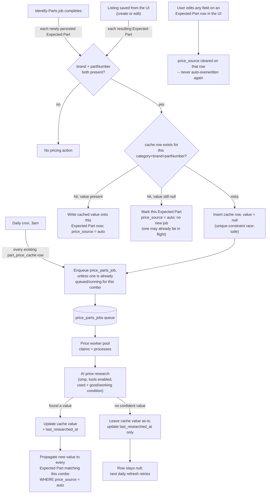

# Feature: part-price-estimation

Status: proposed
Cycle: 0 / 3
FeatureStarted: 2026-10-07T20:51:08Z
OrchestrationTokensActual: 117528
OrchestrationTokensBreakdown: input 0 + output 19,027 + cache-write 30,157 + cache-read 68,344, across 44 turns
Prototype: https://gist.githack.com/adamcrevel/e052384531fe77a7963bf56b2ba58e99/raw/prototype.html
Walkthrough: none
BaselineTests: 561
BaselineSuite: pass

## Goal

Whenever an Expected Part becomes fully identified (it has both a brand and a part number), the
system automatically looks up and attaches an estimated resale value for it in the background — no
user action needed. This happens right after an identify-parts job finishes, and again whenever a
Listing is saved with a part that just became fully identified (for example, the user typed in a
part number by hand). Prices are cached by (category, brand, part number) and reused across all
Listings, refreshed once a day, and never overwritten once a user has set or edited that part's
price themselves.

## Architecture

## Requirements

1. As soon as an identify-parts job finishes saving its identified parts, any resulting Expected
   Part that has both brand and part number automatically gets its estimated resale value
   researched — no further action needed.
2. The researched value is a used, working/good-condition price for that specific category, brand,
   and part number.
3. An Expected Part missing a brand or part number is never auto-researched.
4. Saving a Listing's Expected Parts in the UI (creating or editing) triggers the same automatic
   research for any part that becomes fully identified and doesn't already have an estimated resale
   value.
5. Price research always runs as a background queued job, never synchronously within the request
   that triggered it — true for both the identify-parts trigger and the manual-save trigger.
6. Prices are cached by the combination of category, brand, and part number, and shared across all
   Listings rather than researched separately for each Listing.
7. If a (category, brand, part number) combination already has a cached, non-null price, an
   Expected Part gets that price right away, with no new research call.
8. A once-daily scheduled job re-researches every (category, brand, part number) combination in the
   cache — whether or not it currently has a price — and updates the cache.
9. The first time a (category, brand, part number) combination appears with no cached price, a
   cache row is inserted immediately with no price, so the daily refresh job will find and retry it
   even if the first research attempt fails or is still running.
10. A failed or inconclusive research attempt never deletes or blocks that combination's cache row
    — it stays in place with a null value, ready for the next daily refresh.
11. If a research attempt succeeds but finds no confident price, the cached value stays null —
    never a guessed or zero value.
12. A later refresh that fails to find a value never overwrites an already-cached price with null —
    only a new successful result replaces the cached value.
13. If two writers hit the same (category, brand, part number) for the first time at nearly the
    same moment (two different Listing saves, or a save racing the daily refresh), this never
    produces two diverging cache rows or two duplicate background jobs for that combination.
14. If a user manually enters or edits an Expected Part's estimated resale value, that row is never
    later overwritten by automatic price research or the daily refresh.
15. Editing any field of an Expected Part row stops that row from being auto-managed by price
    research going forward — the same rule that already governs the "AI suggested" flag: touching a
    row means the user now owns it. One consistent rule, not two.
16. After a user clicks "Identify Parts," the status text already shown for that job keeps
    reflecting progress until every price research triggered by that job's completion has also
    finished (found a price, or exhausted its attempt) — not just until the identify-parts job
    itself completes.
17. Price research triggered only by a manual Listing save (not by clicking "Identify Parts") has no
    dedicated status shown in the UI — the price just appears once it's ready, like any other field
    that gets filled in the background.

## Standing Checks

- The full test suite passes, and the test count stays at or above `BaselineTests` (measured fresh
  in this worktree before any change — see header), or the plan states which tests were merged and
  why.
- `npm run lint` (eslint) runs clean with no new violations.
- Any new public function or component this feature adds has the same kind of header/block-comment
  documentation already used elsewhere in the codebase — explaining its purpose and flow, not just a
  one-line label.
- No new code in `apps/web` imports directly from `apps/server` — the existing
  `import/no-restricted-paths` boundary (`eslint.config.mjs`), checked by
  `apps/web/test/eslint-import-boundary.test.ts`, must hold for every file this feature adds or
  touches.
- `part_price_cache` is a brand-new table reached concurrently by more than one previously-separate
  write path (the identify-parts worker, the Listings routes' manual-save path, and the new daily
  refresh job) — prove with a real concurrent-writers test (two genuinely racing calls, not two
  sequential calls, matching this codebase's own `identifyPartsConcurrency.test.ts`/
  `concurrency.test.ts` precedent) that two near-simultaneous first encounters of the same
  (category, brand, part number) never produce two cache rows, two duplicate jobs, or a crash.
- Prove with a real mutation-style regression test (not just "looks right once") that a failed or
  inconclusive refresh attempt never overwrites an already-cached non-null price with null.

## Tasks

| id | description | role | depends_on | status | cycle | model | started_at | completed_at | expected_minutes | estimated_start | estimated_tokens | actual_tokens | ui | files_touched |
|----|----|----|----|----|----|----|----|----|----|----|----|----|----|----|
| P0 | Clickable prototype covering T8-T9: the "Pricing N part(s)…" status text extension to the existing Identify Parts status banner, shown only after clicking Identify Parts and only while any resulting part still needs a price. | prototype | none | complete | 0 | | 2026-10-07T21:06:08Z | 2026-10-07T21:11:42Z | 10 | 2026-10-07T21:06:08Z | 40000 | null | yes | |
| T1 | Schema: add `price_parts_job_stage` ENUM (`queued`, `pricing`, `completed`, `failed`) to `ENUM_STATEMENTS`; add `part_price_cache` table (`id UUID PRIMARY KEY`, `component_category component_category NOT NULL`, `brand VARCHAR NOT NULL`, `part_number VARCHAR NOT NULL`, `estimated_resale_value DECIMAL(10,2)` nullable, `last_researched_at TIMESTAMP` nullable, `created_at`/`updated_at TIMESTAMP NOT NULL DEFAULT current_timestamp`) with a `CREATE UNIQUE INDEX` on `(component_category, brand, part_number)` (Req 13's backstop); add `price_parts_jobs` table (`id UUID PRIMARY KEY`, `component_category`, `brand`, `part_number` — same triple as the cache row it researches, not a `listing_id` FK, since a price job researches a combination shared across Listings, not one Listing's own row — `stage price_parts_job_stage NOT NULL DEFAULT 'queued'`, `error_message VARCHAR`, `created_at`/`started_at`/`completed_at`/`updated_at`, mirroring `identify_parts_jobs`'s own column shape); `ALTER TABLE expected_parts ADD COLUMN IF NOT EXISTS price_source VARCHAR` (nullable; null = not auto-managed — either never eligible or a user has claimed it; `'auto'` = currently under price research/refresh management, mirroring `ai_confidence`/`ai_source`'s own nullable-tag convention). All in `apps/server/src/db/schema.ts`. | builder | none | not_started | 0 | | | | | 25 | | | | no | |
| T2 | AI price-research module: `apps/server/src/ai/priceEstimationPrompt.ts` (`buildPriceEstimationPrompt(category, brand, partNumber)` — asks for a single used, working/good-condition USD resale estimate for the exact part, explicit "say so plainly, do not guess" instruction for no-confident-answer, matching this codebase's existing never-guess convention) and `apps/server/src/ai/priceEstimationParser.ts` (`parsePriceEstimationResponse(rawStdout): number \| null` — a confident numeric answer parses to that number, anything else — refusal, a range, no price found — parses to `null`, never an invented number). Reuses `getOmpSourcingRunner()` from `ompSourcingRunner.ts` (tools enabled, no photo attached) — no new `omp` runner needed. A dedicated `DEFAULT_PRICE_ESTIMATION_TIMEOUT_MS = 180_000` (a single bounded price lookup, not open-ended catalog browsing, so shorter than `DEFAULT_OMP_CATALOG_SOURCING_TIMEOUT_MS`'s 600s but longer than plain identification's 120s). | builder | none | not_started | 0 | | | | | 25 | | | | no | |
| T3 | `part_price_cache` queries: `apps/server/src/db/queries/partPriceCache.ts` — `findPriceCacheEntry(category, brand, partNumber)`, `insertPriceCacheEntry(category, brand, partNumber)` returning `{ inserted: boolean }` (Req 13: plain `INSERT ... VALUES` wrapped in try/catch matching a unique-constraint-violation message, returning `inserted: false` instead of throwing on the race — the exact pattern `apps/server/src/db/queries/referencePhotos.ts`'s `insertReferencePhotoRow` already uses for its own dedup insert, not a new invention), `updatePriceCacheEntryValue(category, brand, partNumber, value: number \| null)` (Req 11-12: when `value` is non-null, `SET estimated_resale_value = value, last_researched_at = now`; when `value` is null, `SET last_researched_at = now` only — the existing `estimated_resale_value` column is never written to null by this function, so a prior success can never regress), `listAllPriceCacheEntries()` (feeds the daily refresh sweep, Req 8), and `propagateCachedPriceToExpectedParts(category, brand, partNumber, value: number)` (`UPDATE expected_parts SET estimated_resale_value = value WHERE component_category = ... AND brand = ... AND part_number = ... AND price_source = 'auto'` — the `price_source = 'auto'` clause is what makes Req 14-15 hold at the database level, not just in application code). | builder | T1 | not_started | 0 | | | | | 25 | | | | no | |
| T4 | `price_source` end to end + the cache-hit/miss trigger decision (Req 1-7, 9, 14-15). Shared types: `packages/shared/src/listings.ts`'s `ExpectedPart`/`ExpectedPartInput` gain `priceSource?: 'auto' \| null` (optional, mirroring `aiConfidence`/`aiSource`'s own existing precedent exactly, for the same backward-fixture-compatibility reason); `apps/server/src/db/types.ts`'s `ExpectedPart` gains the same field (required-but-nullable, matching how `aiConfidence`/`aiSource` are modeled there); `apps/server/src/db/queries/expectedParts.ts`'s `CreateExpectedPartInput`/`mapRow`/`createExpectedPart` thread it through (same shape as `aiConfidence`/`aiSource`'s own threading); `apps/server/src/routes/listingValidation.ts` validates an incoming `priceSource` the same way its existing `validateOptionalEnum` already validates `aiConfidence`/`aiSource`, against the single allowed value `'auto'`. New orchestration file `apps/server/src/jobs/pricePartsTrigger.ts` exports `triggerPriceLookups(expectedParts: ExpectedPart[]): Promise<void>` — for each part with non-null `brand`/`partNumber` and null `estimatedResaleValue`: look up the cache (T3); on a hit with a non-null value, call `propagateCachedPriceToExpectedParts` immediately (no job); on a hit with a still-null value, do nothing further (a job for this combo is presumably already queued/running — checked via a `price_parts_jobs` query for any non-terminal row matching the combo, added to `apps/server/src/db/queries/pricePartsJobs.ts` alongside this task's other new job-table queries: `createQueuedPriceJob`, `claimNextQueuedPriceJob`, `updatePriceJobStage`, `completePriceJob`, `failPriceJob`, `hasNonTerminalPriceJob(category, brand, partNumber)`, mirroring `identify_parts_jobs`'s own query module shape); on a miss, insert the cache row (T3) and, only if `hasNonTerminalPriceJob` is false, enqueue a new `price_parts_job` via `createQueuedPriceJob`. Wire `triggerPriceLookups` into both existing Expected-Part write paths: `apps/server/src/jobs/identifyPartsWorkerPool.ts`'s `persistIdentifiedParts` (right after its existing inserts, setting each newly-created part's `priceSource` to `'auto'` when `part.brand && part.partNumber`, else `null`, at insertion time) and `apps/server/src/routes/listings.ts`'s POST and PUT handlers (right after their existing `createExpectedPart` calls, alongside the existing `promoteReferencesForExpectedParts` call; `priceSource` for each incoming `ExpectedPartInput` is computed the same way — `'auto'` when brand+partNumber are both present AND `estimatedResaleValue` is null, else carried through verbatim from whatever the client sent, which is how Req 14 survives a resave of an already-auto-priced or already-manually-priced row untouched — see T8 for the client-side half of that). | builder | T1;T3 | not_started | 0 | albert-einstein | | | | 45 | | | | no | |
| T5 | Price worker pool: `apps/server/src/jobs/pricePartsWorkerPool.ts`, mirroring `identifyPartsWorkerPool.ts`'s own claim/pump/process shape exactly (a `POOL_SIZE` env knob — `PRICE_PARTS_POOL_SIZE`, same `parsePoolSize` convention — `pump()`/`processJob()`/`startPricePartsWorkerPool()` returning a `{ stop() }` handle, orphaned-job recovery on startup). `processJob` runs T2's prompt+parser via `getOmpSourcingRunner()` for the job's `(category, brand, partNumber)`, then calls T3's `updatePriceCacheEntryValue` and, when a value was found, `propagateCachedPriceToExpectedParts`, then marks the job completed (regardless of whether a price was actually found — Req 11: "no confident price" is a successful, completed job outcoming in a still-null cache value, not a failed job) or failed (only for a genuine `omp` spawn/timeout/crash error, matching `identify_parts_jobs`'s own completed-vs-failed distinction). | builder | T2;T3;T4 | not_started | 0 | | | | | 30 | | | | no | |
| T6 | Daily price-refresh scheduler: `apps/server/src/jobs/priceRefreshScheduler.ts`, mirroring `apps/server/src/scan/scheduler.ts`'s own `node-cron` shape exactly (`runScheduledPriceRefresh()` exported separately for direct unit testing, `startPriceRefreshScheduler()` registering the cron job and returning its `ScheduledTask` handle). Scheduled at `0 3 * * *` (3am — distinct from the existing 2am scan job, Req 8). `runScheduledPriceRefresh` calls T3's `listAllPriceCacheEntries()` and, for each entry, enqueues a `price_parts_job` via T4's `hasNonTerminalPriceJob`-then-`createQueuedPriceJob` dedup check (reused, not reimplemented) — the existing worker pool (T5) processes every enqueued job exactly the same way regardless of whether it came from a fresh trigger or this refresh sweep. | builder | T3;T4 | not_started | 0 | | | | | 20 | | | | no | |
| T7 | Server bootstrap wiring: `apps/server/src/index.ts` starts `startPricePartsWorkerPool()` and `startPriceRefreshScheduler()` alongside the existing identify-parts pool and scan scheduler, and stops both cleanly in `gracefulShutdown()` (same pattern as the two existing handles). | builder | T5;T6 | not_started | 0 | | | | | 10 | | | | no | |
| T8 | Client-side `priceSource` carried through the Expected Parts editor (Req 14-15). `apps/web/src/features/listings/expected-parts-editor.tsx`'s `ExpectedPartRow` gains an optional `priceSource?: 'auto'` field; `updateRow` clears it on any edit, the same single line that already clears `aiSuggested` (one shared "touching a row means the user owns it now" rule, Req 15 — not a second, separately-maintained clearing rule). `apps/web/src/features/listings/listing-form-state.ts`'s `expectedPartToRow` reads `part.priceSource` off the server `ExpectedPart` the same way it already reads `aiConfidence`/`aiSource`. `apps/web/src/features/listings/listing-form.tsx`'s `persistListing` sends `priceSource: row.priceSource === 'auto' ? 'auto' : null` for every outgoing row (Req 14: an untouched auto-priced row keeps being managed; a row the user has edited — `priceSource` already cleared by `updateRow` — stops being managed, the same moment its `aiSuggested` flag would). | builder | T4 | not_started | 0 | | | | | 20 | | | | yes | |
| T9 | `apps/web/src/features/listings/identify-parts-button.tsx`'s status text keeps reporting progress after the identify-parts job itself completes, until every part it triggered pricing for has resolved (Req 16). After `applyTerminalJob` re-fetches the Listing (its existing behavior), if any fetched Expected Part has `priceSource === 'auto'` and a null `estimatedResaleValue`, set a new `pricingStatus` state showing e.g. "Pricing N part(s)…" and start a second poll loop (same 2-second interval the job-stage poll already uses) that re-fetches the Listing and recomputes that still-unpriced count, updating the message each tick, until the count reaches zero (clear `pricingStatus`) or 60 polls (2 minutes) elapse (stop polling silently, clear `pricingStatus`, no error — Req 17's "manual-save pricing has no dedicated status" boundary also means this poll loop must never run for a plain Save, only for the identify-parts completion path). | builder | T8 | not_started | 0 | | | | | 30 | | | | yes | |

## Assumptions

- A1 (cycle 0): `price_parts_jobs` is keyed by (category, brand, part number), not by
  `expected_part_id` or `listing_id`. An Expected Part's own id is unstable (every Listing save
  deletes and recreates all its rows, confirmed in `routes/listings.ts`), and under the
  global-cache decision the researched value is Listing-independent anyway — so a job researching
  one combination isn't really "for" any single Listing or row.
- A2 (cycle 0): No new API route for price-job status. The client (T9) polls the Listing itself
  (`GET /api/listings/:id`, already existing) instead of a dedicated price-job-status endpoint —
  the useful signal for the status banner is "does this Listing still have an auto-priced part
  with no value yet," not "what stage is job X in."
- A3 (cycle 0): `DEFAULT_PRICE_ESTIMATION_TIMEOUT_MS = 180_000` (3 minutes) — between plain
  identification's 120s (`ompRunner.ts`) and catalog browsing's 600s
  (`DEFAULT_OMP_CATALOG_SOURCING_TIMEOUT_MS`), since a price lookup needs real web browsing (unlike
  plain identification) but is one bounded question, not open-ended catalog enumeration.
- A4 (cycle 0): The price-refresh cron runs at `0 3 * * *` (3am), one hour after the existing eBay
  scan's 2am schedule, so the two background jobs never compete for AI/web-call resources at the
  same time.
- A5 (cycle 0): `price_parts_job_stage` is `queued`/`pricing`/`completed`/`failed` — no
  `identify_parts_job_stage`-style intermediate stages, since one price lookup is a single AI call,
  not a multi-phase pipeline.
- A6 (cycle 0): T9's second poll loop gives up after 60 polls (2 minutes) with no remaining unpriced
  parts, as a "the user is still plausibly watching" cutoff — past that point, the daily refresh (or
  a job that's simply taking unusually long) finishes the job without the UI needing to poll
  forever.
- A7 (cycle 0): Manual-save-triggered pricing (Req 17) gets no visible status at all, not even a
  generic "pricing in background" banner — the clarifying answer this was built from specifically
  limited the status requirement to "once you click identify parts."
- A8 (cycle 0): `expected_parts.price_source` has exactly one defined value, `'auto'` — not an enum
  of `'auto'`/`'manual'` — since null already unambiguously means "not auto-managed" (covering both
  "never eligible" and "a user claimed it"), so a separate `'manual'` value would add no information
  that the absence of `'auto'` doesn't already give.

## Cycle Log

### Cycle 0
Trigger: initial
UAT: not_run
