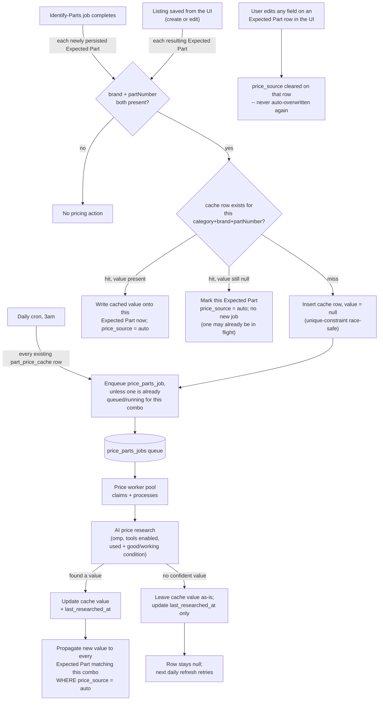

# Feature: part-price-estimation

Status: done
Cycle: 1 / 3
FeatureStarted: 2026-10-07T20:51:08Z
FeatureCompletedAt: 2026-10-08T03:28:37Z
OrchestrationTokensActual: 562149
OrchestrationTokensBreakdown: input 0 + output 81,256 + cache-write 156,070 + cache-read 324,823, across 185 turns
Prototype: https://gist.githack.com/adamcrevel/e052384531fe77a7963bf56b2ba58e99/raw/prototype.html
Walkthrough: https://gist.githack.com/adamcrevel/3e8f4cd40fdbac251a04ec18f99b2bcf/raw/walkthrough.html
BaselineTests: 561
BaselineSuite: pass

## Goal

Whenever an Expected Part becomes fully identified (it has both a brand and a part number), the
system automatically looks up and attaches an estimated resale value for it in the background — no
user action needed. This happens right after an identify-parts job finishes, and again whenever a
Listing is saved with a part that just became fully identified (for example, the user typed in a
part number by hand). Prices are cached by (category, brand, part number) and reused across all
Listings, refreshed once a day, and never overwritten once a user has set or edited that part's
price themselves.

## Architecture

## Requirements

1. As soon as an identify-parts job finishes saving its identified parts, any resulting Expected
   Part that has both brand and part number automatically gets its estimated resale value
   researched — no further action needed.
2. The researched value is a used, working/good-condition price for that specific category, brand,
   and part number.
3. An Expected Part missing a brand or part number is never auto-researched.
4. Saving a Listing's Expected Parts in the UI (creating or editing) triggers the same automatic
   research for any part that becomes fully identified and doesn't already have an estimated resale
   value.
5. Price research always runs as a background queued job, never synchronously within the request
   that triggered it — true for both the identify-parts trigger and the manual-save trigger.
6. Prices are cached by the combination of category, brand, and part number, and shared across all
   Listings rather than researched separately for each Listing.
7. If a (category, brand, part number) combination already has a cached, non-null price, an
   Expected Part gets that price right away, with no new research call.
8. A once-daily scheduled job re-researches every (category, brand, part number) combination in the
   cache — whether or not it currently has a price — and updates the cache.
9. The first time a (category, brand, part number) combination appears with no cached price, a
   cache row is inserted immediately with no price, so the daily refresh job will find and retry it
   even if the first research attempt fails or is still running.
10. A failed or inconclusive research attempt never deletes or blocks that combination's cache row
    — it stays in place with a null value, ready for the next daily refresh.
11. If a research attempt succeeds but finds no confident price, the cached value stays null —
    never a guessed or zero value.
12. A later refresh that fails to find a value never overwrites an already-cached price with null —
    only a new successful result replaces the cached value.
13. If two writers hit the same (category, brand, part number) for the first time at nearly the
    same moment (two different Listing saves, or a save racing the daily refresh), this never
    produces two diverging cache rows or two duplicate background jobs for that combination.
14. If a user manually enters or edits an Expected Part's estimated resale value, that row is never
    later overwritten by automatic price research or the daily refresh.
15. Editing any field of an Expected Part row stops that row from being auto-managed by price
    research going forward — the same rule that already governs the "AI suggested" flag: touching a
    row means the user now owns it. One consistent rule, not two.
16. After a user clicks "Identify Parts," the status text already shown for that job keeps
    reflecting progress until every price research triggered by that job's completion has also
    finished (found a price, or exhausted its attempt) — not just until the identify-parts job
    itself completes.
17. Price research triggered only by a manual Listing save (not by clicking "Identify Parts") has no
    dedicated status shown in the UI — the price just appears once it's ready, like any other field
    that gets filled in the background.

## Standing Checks

- The full test suite passes, and the test count stays at or above `BaselineTests` (measured fresh
  in this worktree before any change — see header), or the plan states which tests were merged and
  why.
- `npm run lint` (eslint) runs clean with no new violations.
- Any new public function or component this feature adds has the same kind of header/block-comment
  documentation already used elsewhere in the codebase — explaining its purpose and flow, not just a
  one-line label.
- No new code in `apps/web` imports directly from `apps/server` — the existing
  `import/no-restricted-paths` boundary (`eslint.config.mjs`), checked by
  `apps/web/test/eslint-import-boundary.test.ts`, must hold for every file this feature adds or
  touches.
- `part_price_cache` is a brand-new table reached concurrently by more than one previously-separate
  write path (the identify-parts worker, the Listings routes' manual-save path, and the new daily
  refresh job) — prove with a real concurrent-writers test (two genuinely racing calls, not two
  sequential calls, matching this codebase's own `identifyPartsConcurrency.test.ts`/
  `concurrency.test.ts` precedent) that two near-simultaneous first encounters of the same
  (category, brand, part number) never produce two cache rows, two duplicate jobs, or a crash.
- Prove with a real mutation-style regression test (not just "looks right once") that a failed or
  inconclusive refresh attempt never overwrites an already-cached non-null price with null.

## Tasks

| id | description | role | depends_on | status | cycle | model | started_at | completed_at | expected_minutes | estimated_start | estimated_tokens | actual_tokens | ui | files_touched |
|----|----|----|----|----|----|----|----|----|----|----|----|----|----|----|
| P0 | Clickable prototype covering T8-T9: the "Pricing N part(s)…" status text extension to the existing Identify Parts status banner, shown only after clicking Identify Parts and only while any resulting part still needs a price. | prototype | none | complete | 0 | | 2026-10-07T21:06:08Z | 2026-10-07T21:11:42Z | 10 | 2026-10-07T21:06:08Z | 40000 | null | yes | |
| T1 | Schema: add `price_parts_job_stage` ENUM (`queued`, `pricing`, `completed`, `failed`) to `ENUM_STATEMENTS`; add `part_price_cache` table (`id UUID PRIMARY KEY`, `component_category component_category NOT NULL`, `brand VARCHAR NOT NULL`, `part_number VARCHAR NOT NULL`, `estimated_resale_value DECIMAL(10,2)` nullable, `last_researched_at TIMESTAMP` nullable, `created_at`/`updated_at TIMESTAMP NOT NULL DEFAULT current_timestamp`) with a `CREATE UNIQUE INDEX` on `(component_category, brand, part_number)` (Req 13's backstop); add `price_parts_jobs` table (`id UUID PRIMARY KEY`, `component_category`, `brand`, `part_number` — same triple as the cache row it researches, not a `listing_id` FK, since a price job researches a combination shared across Listings, not one Listing's own row — `stage price_parts_job_stage NOT NULL DEFAULT 'queued'`, `error_message VARCHAR`, `created_at`/`started_at`/`completed_at`/`updated_at`, mirroring `identify_parts_jobs`'s own column shape); `ALTER TABLE expected_parts ADD COLUMN IF NOT EXISTS price_source VARCHAR` (nullable; null = not auto-managed — either never eligible or a user has claimed it; `'auto'` = currently under price research/refresh management, mirroring `ai_confidence`/`ai_source`'s own nullable-tag convention). All in `apps/server/src/db/schema.ts`. | builder | none | complete | 0 | | 2026-10-07T21:50:12Z | 2026-10-07T21:57:13Z | 25 | 2026-10-07T21:47:08Z | 8700 | null | no | apps/server/src/db/schema.ts |
| T2 | AI price-research module: `apps/server/src/ai/priceEstimationPrompt.ts` (`buildPriceEstimationPrompt(category, brand, partNumber)` — asks for a single used, working/good-condition USD resale estimate for the exact part, explicit "say so plainly, do not guess" instruction for no-confident-answer, matching this codebase's existing never-guess convention) and `apps/server/src/ai/priceEstimationParser.ts` (`parsePriceEstimationResponse(rawStdout): number \| null` — a confident numeric answer parses to that number, anything else — refusal, a range, no price found — parses to `null`, never an invented number). Reuses `getOmpSourcingRunner()` from `ompSourcingRunner.ts` (tools enabled, no photo attached) — no new `omp` runner needed. A dedicated `DEFAULT_PRICE_ESTIMATION_TIMEOUT_MS = 180_000` (a single bounded price lookup, not open-ended catalog browsing, so shorter than `DEFAULT_OMP_CATALOG_SOURCING_TIMEOUT_MS`'s 600s but longer than plain identification's 120s). | builder | none | complete | 0 | | 2026-10-07T21:50:12Z | 2026-10-07T21:57:13Z | 25 | 2026-10-07T22:12:08Z | 29900 | null | no | apps/server/src/ai/priceEstimationPrompt.ts; apps/server/src/ai/priceEstimationParser.ts; apps/server/test/priceEstimation.test.ts |
| T3 | `part_price_cache` queries: `apps/server/src/db/queries/partPriceCache.ts` — `findPriceCacheEntry(category, brand, partNumber)`, `insertPriceCacheEntry(category, brand, partNumber)` returning `{ inserted: boolean }` (Req 13: plain `INSERT ... VALUES` wrapped in try/catch matching a unique-constraint-violation message, returning `inserted: false` instead of throwing on the race — the exact pattern `apps/server/src/db/queries/referencePhotos.ts`'s `insertReferencePhotoRow` already uses for its own dedup insert, not a new invention), `updatePriceCacheEntryValue(category, brand, partNumber, value: number \| null)` (Req 11-12: when `value` is non-null, `SET estimated_resale_value = value, last_researched_at = now`; when `value` is null, `SET last_researched_at = now` only — the existing `estimated_resale_value` column is never written to null by this function, so a prior success can never regress), `listAllPriceCacheEntries()` (feeds the daily refresh sweep, Req 8), and `propagateCachedPriceToExpectedParts(category, brand, partNumber, value: number)` (`UPDATE expected_parts SET estimated_resale_value = value WHERE component_category = ... AND brand = ... AND part_number = ... AND price_source = 'auto'` — the `price_source = 'auto'` clause is what makes Req 14-15 hold at the database level, not just in application code). | builder | T1 | complete | 0 | | 2026-10-07T21:57:25Z | 2026-10-07T22:04:47Z | 25 | 2026-10-07T22:37:08Z | 48000 | null | no | apps/server/src/db/queries/partPriceCache.ts; apps/server/test/partPriceCache.test.ts; apps/server/src/db/types.ts; apps/server/src/db/index.ts |
| T4 | `price_source` end to end + the cache-hit/miss trigger decision (Req 1-7, 9, 14-15). Shared types: `packages/shared/src/listings.ts`'s `ExpectedPart`/`ExpectedPartInput` gain `priceSource?: 'auto' \| null` (optional, mirroring `aiConfidence`/`aiSource`'s own existing precedent exactly, for the same backward-fixture-compatibility reason); `apps/server/src/db/types.ts`'s `ExpectedPart` gains the same field (required-but-nullable, matching how `aiConfidence`/`aiSource` are modeled there); `apps/server/src/db/queries/expectedParts.ts`'s `CreateExpectedPartInput`/`mapRow`/`createExpectedPart` thread it through (same shape as `aiConfidence`/`aiSource`'s own threading); `apps/server/src/routes/listingValidation.ts` validates an incoming `priceSource` the same way its existing `validateOptionalEnum` already validates `aiConfidence`/`aiSource`, against the single allowed value `'auto'`. New orchestration file `apps/server/src/jobs/pricePartsTrigger.ts` exports `triggerPriceLookups(expectedParts: ExpectedPart[]): Promise<void>` — for each part with non-null `brand`/`partNumber` and null `estimatedResaleValue`: look up the cache (T3); on a hit with a non-null value, call `propagateCachedPriceToExpectedParts` immediately (no job); on a hit with a still-null value, do nothing further (a job for this combo is presumably already queued/running — checked via a `price_parts_jobs` query for any non-terminal row matching the combo, added to `apps/server/src/db/queries/pricePartsJobs.ts` alongside this task's other new job-table queries: `createQueuedPriceJob`, `claimNextQueuedPriceJob`, `updatePriceJobStage`, `completePriceJob`, `failPriceJob`, `hasNonTerminalPriceJob(category, brand, partNumber)`, mirroring `identify_parts_jobs`'s own query module shape); on a miss, insert the cache row (T3) and, only if `hasNonTerminalPriceJob` is false, enqueue a new `price_parts_job` via `createQueuedPriceJob`. Wire `triggerPriceLookups` into both existing Expected-Part write paths: `apps/server/src/jobs/identifyPartsWorkerPool.ts`'s `persistIdentifiedParts` (right after its existing inserts, setting each newly-created part's `priceSource` to `'auto'` when `part.brand && part.partNumber`, else `null`, at insertion time) and `apps/server/src/routes/listings.ts`'s POST and PUT handlers (right after their existing `createExpectedPart` calls, alongside the existing `promoteReferencesForExpectedParts` call; `priceSource` for each incoming `ExpectedPartInput` is computed the same way — `'auto'` when brand+partNumber are both present AND `estimatedResaleValue` is null, else carried through verbatim from whatever the client sent, which is how Req 14 survives a resave of an already-auto-priced or already-manually-priced row untouched — see T8 for the client-side half of that). | builder | T1;T3 | complete | 0 | albert-einstein | 2026-10-07T22:04:47Z | 2026-10-07T22:28:39Z | 45 | 2026-10-07T23:02:08Z | 44000 | null | no | packages/shared/src/listings.ts; apps/server/src/db/types.ts; apps/server/src/db/queries/expectedParts.ts; apps/server/src/routes/listingValidation.ts; apps/server/src/routes/listings.ts; apps/server/src/jobs/identifyPartsWorkerPool.ts; apps/server/src/db/index.ts; apps/server/src/db/migrate.ts; apps/server/src/db/queries/pricePartsJobs.ts; apps/server/src/jobs/pricePartsTrigger.ts; apps/server/test/pricePartsJobs.test.ts; apps/server/test/pricePartsTrigger.test.ts; apps/server/test/identifyPartsPriceTrigger.test.ts; apps/server/test/priceSourceRoute.test.ts |
| T5 | Price worker pool: `apps/server/src/jobs/pricePartsWorkerPool.ts`, mirroring `identifyPartsWorkerPool.ts`'s own claim/pump/process shape exactly (a `POOL_SIZE` env knob — `PRICE_PARTS_POOL_SIZE`, same `parsePoolSize` convention — `pump()`/`processJob()`/`startPricePartsWorkerPool()` returning a `{ stop() }` handle, orphaned-job recovery on startup). `processJob` runs T2's prompt+parser via `getOmpSourcingRunner()` for the job's `(category, brand, partNumber)`, then calls T3's `updatePriceCacheEntryValue` and, when a value was found, `propagateCachedPriceToExpectedParts`, then marks the job completed (regardless of whether a price was actually found — Req 11: "no confident price" is a successful, completed job outcoming in a still-null cache value, not a failed job) or failed (only for a genuine `omp` spawn/timeout/crash error, matching `identify_parts_jobs`'s own completed-vs-failed distinction). | builder | T2;T3;T4 | complete | 0 | | 2026-10-07T22:28:39Z | 2026-10-07T22:35:28Z | 30 | 2026-10-07T23:47:08Z | 16000 | null | no | apps/server/src/jobs/pricePartsWorkerPool.ts; apps/server/test/pricePartsWorkerPool.test.ts; apps/server/src/db/queries/pricePartsJobs.ts |
| T6 | Daily price-refresh scheduler: `apps/server/src/jobs/priceRefreshScheduler.ts`, mirroring `apps/server/src/scan/scheduler.ts`'s own `node-cron` shape exactly (`runScheduledPriceRefresh()` exported separately for direct unit testing, `startPriceRefreshScheduler()` registering the cron job and returning its `ScheduledTask` handle). Scheduled at `0 3 * * *` (3am — distinct from the existing 2am scan job, Req 8). `runScheduledPriceRefresh` calls T3's `listAllPriceCacheEntries()` and, for each entry, enqueues a `price_parts_job` via T4's `hasNonTerminalPriceJob`-then-`createQueuedPriceJob` dedup check (reused, not reimplemented) — the existing worker pool (T5) processes every enqueued job exactly the same way regardless of whether it came from a fresh trigger or this refresh sweep. | builder | T3;T4 | complete | 0 | | 2026-10-07T22:35:28Z | 2026-10-07T22:39:33Z | 20 | 2026-10-08T00:17:08Z | 24000 | null | no | apps/server/src/jobs/priceRefreshScheduler.ts; apps/server/test/priceRefreshScheduler.test.ts |
| T7 | Server bootstrap wiring: `apps/server/src/index.ts` starts `startPricePartsWorkerPool()` and `startPriceRefreshScheduler()` alongside the existing identify-parts pool and scan scheduler, and stops both cleanly in `gracefulShutdown()` (same pattern as the two existing handles). | builder | T5;T6 | complete | 0 | | 2026-10-07T22:39:33Z | 2026-10-07T22:42:44Z | 10 | 2026-10-08T00:37:08Z | 5900 | null | no | apps/server/src/index.ts |
| T8 | Client-side `priceSource` carried through the Expected Parts editor (Req 14-15). `apps/web/src/features/listings/expected-parts-editor.tsx`'s `ExpectedPartRow` gains an optional `priceSource?: 'auto'` field; `updateRow` clears it on any edit, the same single line that already clears `aiSuggested` (one shared "touching a row means the user owns it now" rule, Req 15 — not a second, separately-maintained clearing rule). `apps/web/src/features/listings/listing-form-state.ts`'s `expectedPartToRow` reads `part.priceSource` off the server `ExpectedPart` the same way it already reads `aiConfidence`/`aiSource`. `apps/web/src/features/listings/listing-form.tsx`'s `persistListing` sends `priceSource: row.priceSource === 'auto' ? 'auto' : null` for every outgoing row (Req 14: an untouched auto-priced row keeps being managed; a row the user has edited — `priceSource` already cleared by `updateRow` — stops being managed, the same moment its `aiSuggested` flag would). | builder | T4 | complete | 0 | | 2026-10-07T22:35:28Z | 2026-10-07T22:39:33Z | 20 | 2026-10-08T00:47:08Z | 21000 | null | yes | apps/web/src/features/listings/expected-parts-editor.tsx; apps/web/src/features/listings/listing-form-state.ts; apps/web/src/features/listings/listing-form.tsx |
| T9 | `apps/web/src/features/listings/identify-parts-button.tsx`'s status text keeps reporting progress after the identify-parts job itself completes, until every part it triggered pricing for has resolved (Req 16). After `applyTerminalJob` re-fetches the Listing (its existing behavior), if any fetched Expected Part has `priceSource === 'auto'` and a null `estimatedResaleValue`, set a new `pricingStatus` state showing e.g. "Pricing N part(s)…" and start a second poll loop (same 2-second interval the job-stage poll already uses) that re-fetches the Listing and recomputes that still-unpriced count, updating the message each tick, until the count reaches zero (clear `pricingStatus`) or 60 polls (2 minutes) elapse (stop polling silently, clear `pricingStatus`, no error — Req 17's "manual-save pricing has no dedicated status" boundary also means this poll loop must never run for a plain Save, only for the identify-parts completion path). | builder | T8 | complete | 0 | | 2026-10-07T22:39:33Z | 2026-10-07T22:42:44Z | 30 | 2026-10-08T01:07:08Z | 10600 | null | yes | apps/web/src/features/listings/identify-parts-button.tsx |
| T1-review | Review T1 (`apps/server/src/db/schema.ts`: `price_parts_job_stage` ENUM, `part_price_cache` table with its `CREATE UNIQUE INDEX` on `(component_category, brand, part_number)`, `price_parts_jobs` table, `expected_parts.price_source` column) against Req 6 (cache keyed by category/brand/partNumber with no `listing_id` FK — structurally enables cross-Listing sharing) and Req 13 (unique-index race backstop). Confirm column types/nullability match spec exactly (`estimated_resale_value` nullable `DECIMAL(10,2)`, `last_researched_at` nullable `TIMESTAMP`); migrate.ts's price_source column in the nullable-price-rebuild's CREATE TABLE/INSERT lists was already independently confirmed clean by the orchestrator, no need to re-verify. PASS — no scope creep, columns/index match spec exactly. | reviewer | T1 | complete | 0 | | 2026-10-07T22:56:13Z | 2026-10-07T23:44:00Z | 10 | 2026-10-07T22:56:13Z | 9200 | null | no | |
| T1-test | Test T1's schema.ts directly: confirm `part_price_cache`'s unique index on `(component_category, brand, part_number)` genuinely rejects a duplicate insert (Req 13 backstop), and `price_parts_job_stage`'s four values are all accepted/rejected correctly. Files: `apps/server/src/db/schema.ts`. PASS on the asked proof (7 new tests, mutation-killed); FOUND a real regression: `db.test.ts`'s `EXPECTED_COLUMNS` fixture was never updated for T1's new tables/column, failing 2 pre-existing tests in the full suite. | tester | T1 | complete | 0 | | 2026-10-07T22:56:13Z | 2026-10-07T23:44:00Z | 10 | 2026-10-07T22:56:13Z | 48000 | null | no | apps/server/test/db.test.ts |
| T2-review | Review T2 (`apps/server/src/ai/priceEstimationPrompt.ts`, `priceEstimationParser.ts`) against Req 2 (used/working-good-condition price for the exact category/brand/partNumber) and Req 11 (no confident answer parses to null, never an invented/guessed number). Confirm `buildPriceEstimationPrompt`'s wording actually asks for used/working condition and explicitly instructs "say so, don't guess" for the no-answer case; confirm `parsePriceEstimationResponse`'s only non-null return path is a genuinely confident numeric answer. Check header/doc-comment convention (Standing Checks) on both new files. FAIL — production code correct; one existing test asserts two independently-satisfiable substrings instead of the actual rule-4 sentence, so it can't catch that rule's deletion. | reviewer | T2 | complete | 0 | | 2026-10-07T22:56:13Z | 2026-10-07T23:44:00Z | 10 | 2026-10-07T22:56:13Z | 10700 | null | no | |
| T2-test | Run and extend `apps/server/test/priceEstimation.test.ts`: confirm prompt wording (used/working-condition ask, explicit no-guess instruction) and parser behavior across confident/refusal/range/non-JSON inputs, matching Req 2/11. Report real pass/fail output. PASS — 20/20, 6 mutations killed. | tester | T2 | complete | 0 | | 2026-10-07T22:56:13Z | 2026-10-07T23:44:00Z | 15 | 2026-10-07T22:56:13Z | 29000 | null | no | apps/server/test/priceEstimation.test.ts |
| T3-review | Review T3 (`apps/server/src/db/queries/partPriceCache.ts`) against Req 6 (triple-keyed, no Listing scoping anywhere in these queries), Req 9 (`insertPriceCacheEntry` is what T4 calls immediately on a cache miss — confirm it genuinely inserts now, race-safely), Req 10 (confirm no delete/clear function exists anywhere in this file, and `updatePriceCacheEntryValue`'s null branch never touches `estimated_resale_value`), Req 11-12 (own, explicit — null branch never overwrites a non-null price; only the non-null-value branch sets it), Req 13 (own — try/catch unique-violation insert matching `referencePhotos.ts`'s pattern; confirm the error-message match is specific enough not to swallow unrelated DB errors), Req 14-15 (own — `propagateCachedPriceToExpectedParts`'s `WHERE price_source = 'auto'` clause present and correctly placed). PASS — clean on all points. | reviewer | T3 | complete | 0 | | 2026-10-07T22:56:13Z | 2026-10-07T23:44:00Z | 15 | 2026-10-07T22:56:13Z | 9300 | null | no | |
| T3-test | Test T3: (1) a genuine mutation-style regression test proving a failed/inconclusive refresh (`updatePriceCacheEntryValue(..., null)`) never overwrites an already-cached non-null `estimated_resale_value` (Req 12, Standing Check). (2) `insertPriceCacheEntry`'s race-safety with a REAL concurrent test (Promise.all) proving only one row results (Req 13, Standing Check). PASS — both proofs already existed verbatim in `partPriceCache.test.ts` (11/11 pass). | tester | T3 | complete | 0 | | 2026-10-07T22:56:13Z | 2026-10-07T23:44:00Z | 20 | 2026-10-07T22:56:13Z | 28000 | null | no | |
| T4-review | Review T4 — the feature's largest, most cross-cutting task (10 files); escalated to a larger model, given correspondingly careful scrutiny (Req 1,3,4,5,6,7,9,13,14,15). FAIL, 2 must_fix: (1) HIGH, empirically proven: `hasNonTerminalPriceJob`+`createQueuedPriceJob` in `pricePartsTrigger.ts:80-83` are two separate statements with no atomicity, so two genuinely concurrent first-encounters of one combo both read "no job yet" and both enqueue — real duplicate `price_parts_jobs` rows, proven against a real DuckDB file. (2) MED, concrete: `routes/listings.ts:111-114` evaluates the "fully-identified+unpriced" condition BEFORE honoring a client-sent `priceSource:null`, so a user who clears an auto-priced value and saves gets it silently re-claimed and the deleted price reappears in the very same response (Req 14/15 violation). Also: the suite's only Req-13 "concurrency" tests mock the gate to a fixed answer and can't observe the real race (Standing Check unmet). 1 low info-only note. | reviewer | T4 | complete | 0 | albert-einstein | 2026-10-07T22:56:13Z | 2026-10-07T23:44:00Z | 30 | 2026-10-07T22:56:13Z | 41000 | null | no | |
| T4-test | Test T4 — same large-scope task, correspondingly thorough. FAIL, 58 tests run, 3 real failures, all the same root cause as ReviewT4's finding (1): a real HTTP two-writer race (two concurrent Listing saves on one brand-new combo) and an in-process 2-way and 8-way race both independently reproduce 2 and 8 duplicate `price_parts_jobs` rows respectively. Req 1/3/4/5/14 end-to-end all otherwise PASS, each mutation-proven. | tester | T4 | complete | 0 | albert-einstein | 2026-10-07T22:56:13Z | 2026-10-07T23:44:00Z | 35 | 2026-10-07T22:56:13Z | 44000 | null | no | apps/server/test/pricePartsConcurrency.test.ts (new, 20 tests); apps/server/test/pricePartsTriggerRace.test.ts (new, 2 tests) |
| T5-review | Review T5 (`apps/server/src/jobs/pricePartsWorkerPool.ts`, and its addition to `db/queries/pricePartsJobs.ts` — `resetOrphanedPriceJobsToQueued` per A13) against Req 10, Req 11 (own), and orphan-recovery correctness. Code itself correct on all three points. FAIL, 1 must_fix: `resetOrphanedPriceJobsToQueued` had no test anywhere that ran its real SQL (unlike its `identifyPartsJobs.ts` sibling, which has a dedicated DB-level test) — a broadened `WHERE` clause would ship undetected. RESOLVED same pass: T5-test (below) added exactly that missing test, mutation-proven. | reviewer | T5 | complete | 0 | | 2026-10-07T22:56:13Z | 2026-10-07T23:44:00Z | 15 | 2026-10-07T22:56:13Z | 15000 | null | no | |
| T5-test | Test T5: `pricePartsWorkerPool`'s claim/pump/process cycle, completed-vs-failed branching (Req 11), and `resetOrphanedPriceJobsToQueued`'s orphan-recovery. Dispatched after T4-test returned (shared file `pricePartsJobs.ts`). PASS — added the real DB-backed orphan-recovery test ReviewT5 flagged as missing (mutation-killed by broadening the WHERE clause exactly as ReviewT5 predicted); worker-pool's existing 8 tests already covered Req 11 and were confirmed green. | tester | T4-test | complete | 0 | | 2026-10-07T23:44:00Z | 2026-10-07T23:44:00Z | 20 | 2026-10-07T23:44:00Z | 12600 | null | no | apps/server/test/pricePartsJobs.test.ts |
| T6-review | Review T6 (`apps/server/src/jobs/priceRefreshScheduler.ts`) against Req 8 and dedup-reuse. PASS, with 1 non-blocking med finding: `runScheduledPriceRefresh` wraps the whole nightly sweep in one outer try/catch with no per-entry isolation — unlike its own sibling `scanService.ts`'s `scanAllEligibleSources`, which explicitly isolates each item so one failure doesn't block the rest — so one transient DB error mid-sweep silently drops every remaining combo that night, untested. | reviewer | T6 | complete | 0 | | 2026-10-07T22:56:13Z | 2026-10-07T23:44:00Z | 10 | 2026-10-07T22:56:13Z | 10100 | null | no | |
| T6-test | Test T6: `runScheduledPriceRefresh` enqueues for every entry (incl. already-priced) and dedups already-non-terminal ones. PASS — wrote `priceRefreshScheduler.test.ts` from scratch (file didn't exist), 5/5 pass, mirroring `scheduler.test.ts`. | tester | T6 | complete | 0 | | 2026-10-07T22:56:13Z | 2026-10-07T23:44:00Z | 15 | 2026-10-07T22:56:13Z | 29000 | null | no | apps/server/test/priceRefreshScheduler.test.ts |
| T7-review | Review T7 (`apps/server/src/index.ts`) — bootstrap/shutdown symmetry with the two existing handles. PASS — confirmed symmetric start/stop, no asymmetry. | reviewer | T7 | complete | 0 | | 2026-10-07T22:56:13Z | 2026-10-07T23:44:00Z | 8 | 2026-10-07T22:56:13Z | 10800 | null | no | |
| T7-test | Test T7: no dedicated test existed for this pure-wiring task; determine whether covered or write one. PASS — confirmed `gracefulShutdown.test.ts`'s 3 existing tests covered none of this (not even the two pre-existing handles); added a 4th real test booting the server, sending SIGTERM, and confirming both new services registered and stopped cleanly. 4/4 pass. | tester | T7 | complete | 0 | | 2026-10-07T22:56:13Z | 2026-10-07T23:44:00Z | 15 | 2026-10-07T22:56:13Z | 22500 | null | no | apps/server/test/gracefulShutdown.test.ts |
| T8-review | Review T8 (expected-parts-editor.tsx, listing-form-state.ts, listing-form.tsx) against Req 14/15, and whether A15's "no test convention" rationale holds against the real `listing-form-state.test.ts` aiConfidence/aiSource precedent. Production code confirmed correct and matches spec precisely. Initial FAIL finding (test file's clears-on-edit block didn't assert priceSource at all) was READ MID-WRITE by the concurrently-dispatched T8-test — confirmed by direct re-read after both agents returned that the file's final state (lines 167-201) does assert priceSource via a dedicated `<output>` element in all 3 cases; finding is stale, not a live defect. Effectively PASS. | reviewer | T8 | complete | 0 | | 2026-10-07T22:56:13Z | 2026-10-07T23:44:00Z | 12 | 2026-10-07T22:56:13Z | 16000 | null | no | |
| T8-test | Test T8 — confirmed via grep no existing web test touched `priceSource`. PASS — wrote `price-source.test.tsx` (9/9 pass), self-caught and strengthened an initially-weak DOM-proxy assertion into a direct `<output>`-element priceSource read during the same run; all 3 requirement-carrying behaviors mutation-proven against the real production files. | tester | T8 | complete | 0 | | 2026-10-07T22:56:13Z | 2026-10-07T23:44:00Z | 20 | 2026-10-07T22:56:13Z | 15000 | null | no | apps/web/test/price-source.test.tsx |
| T9-review | Review T9 (identify-parts-button.tsx) against Req 16/17, A6, A16. All behavioral points confirmed correct against the current, settled file (re-verified directly after this review's own notes flagged a transient mid-mutation read it did not end up relying on). FAIL, 1 must_fix: real `eslint --rule complexity` run measures the component's complexity at 14, but its own doc comment still claims "exactly 10" — a stale, actively-wrong comment this task's own additions pushed past the threshold it documents. | reviewer | T9 | complete | 0 | | 2026-10-07T22:56:13Z | 2026-10-07T23:44:00Z | 12 | 2026-10-07T22:56:13Z | 32000 | null | no | |
| T9-test | Test T9 — confirmed via grep no existing web test touched pricingStatus/"Pricing". PASS — added 5 tests to `identify-parts.test.tsx` (20/20 pass total), all 4 requirement-carrying behaviors mutation-proven against the real production file (exact 60-poll boundary, zero-clears, onPartsSaved-per-tick, Req 17 absence). | tester | T9 | complete | 0 | | 2026-10-07T22:56:13Z | 2026-10-07T23:44:00Z | 20 | 2026-10-07T22:56:13Z | 17000 | null | no | apps/web/test/identify-parts.test.tsx |
| T10 | **Cycle 1 fix (from T1-test's must_fix).** `apps/server/test/db.test.ts`'s `EXPECTED_COLUMNS` fixture is stale against the real schema: it's missing `part_price_cache`, `price_parts_jobs` (so "creates exactly the N tables" fails, 13 found vs 11 expected) and `expected_parts.price_source` (so "`expected_parts` has the expected columns in order" fails, 11 found vs 10 expected). Update the fixture to match `schema.ts`'s current, real column/table set exactly — no production code change. | builder | none | complete | 1 | derek-zoolander | 2026-10-08T00:02:09Z | 2026-10-08T00:11:00Z | 10 | 2026-10-07T23:55:07Z | 5000 | null | no | apps/server/test/db.test.ts |
| T11 | **Cycle 1 fix (from T2-review's must_fix).** `apps/server/test/priceEstimation.test.ts:45`'s Req-11 guard test asserts only that the full prompt string contains the independent substrings `'confident'` and `'guess'` — both already appear elsewhere in the prompt (the JSON output examples contain "confident"; a different rule's "round-trip-guess" contains "guess"), so deleting the actual no-guess instruction (rule 4) leaves this test green. Rewrite the assertion to target rule 4's own sentence specifically (e.g. match the literal instruction text, or assert the specific phrase that only rule 4 contains), so removing that one rule fails the test. | builder | none | complete | 1 | | 2026-10-08T00:02:09Z | 2026-10-08T00:11:00Z | 15 | 2026-10-08T00:05:07Z | 3200 | null | no | apps/server/test/priceEstimation.test.ts |
| T12 | **Cycle 1 fix (from T4-review/T4-test's must_fix, part 1 of 2 — the race).** `pricePartsJobs.ts`'s `createQueuedPriceJob` and `hasNonTerminalPriceJob` in `pricePartsTrigger.ts` are two separate, non-atomic statements: two genuinely concurrent first-encounters of the same (category, brand, part number) both read "no job yet" before either insert lands, producing two `price_parts_jobs` rows for one combo (proven live against a real DuckDB file; reproduced by both `apps/server/test/pricePartsConcurrency.test.ts` and `apps/server/test/pricePartsTriggerRace.test.ts`, already written and currently failing). Fix: replace the separate SELECT-then-INSERT with one atomic `INSERT INTO price_parts_jobs (...) SELECT $values WHERE NOT EXISTS (SELECT 1 FROM price_parts_jobs WHERE component_category = $category AND brand = $brand AND part_number = $part_number AND stage IN ('queued', 'pricing'))` — the exact INSERT-SELECT-WHERE-NOT-EXISTS pattern `apps/server/src/db/queries/referencePhotos.ts`'s `insertReferencePhotoRow` already uses for its own nullable-part-number dedup case, not a new invention. Return whether a row was actually inserted. Both existing race tests must pass for real afterward, unmodified in their own assertions (they already assert the correct "exactly one job" outcome). | builder | none | complete | 1 | | 2026-10-08T00:02:09Z | 2026-10-08T00:11:00Z | 25 | 2026-10-08T00:20:07Z | 42000 | null | no | apps/server/src/db/queries/pricePartsJobs.ts; apps/server/src/jobs/pricePartsTrigger.ts; apps/server/test/pricePartsTrigger.test.ts |
| T13 | **Cycle 1 fix (from T4-review's must_fix, part 2 of 2 — the priceSource semantics bug, and a correction to Assumption A8).** The actual root cause: `expected_parts.price_source` as a two-value field (`'auto' \| null`) cannot distinguish "never eligible for auto-pricing" from "a user explicitly cleared a previously auto-priced value" — both look identical on the wire (`brand`/`partNumber` present, `estimatedResaleValue: null`, `priceSource: null`), so `routes/listings.ts`'s auto-claim derivation can't tell them apart and silently re-claims a row the user just rejected, then `triggerPriceLookups` writes the still-cached price straight back onto it in the same request (direct Req 14/15 violation; `priceSourceRoute.test.ts`'s test meant to catch exactly this uses a non-null value and never exercises the real bug). Fix: make `price_source` a proper three-state field, `'auto' \| 'manual' \| null` (no schema/column change — still one nullable VARCHAR, now storing one of two meaningful strings instead of one). `null` = undecided (eligible for auto-claiming the first time brand+partNumber become complete, same as before). `'auto'` = currently under automatic management. `'manual'` = the user has explicitly taken ownership (by typing a value, or by clearing one that was previously `'auto'`) — never auto-claimed again. Server: `routes/listings.ts`'s derivation only assigns `'auto'` when the incoming row's own `priceSource` is `null`/absent (undecided) AND brand+partNumber are present AND the value is null; an incoming `'manual'` or `'auto'` is stored verbatim, never overridden. Client (`apps/web/src/features/listings/expected-parts-editor.tsx`'s `updateRow`): when the row being edited currently has `priceSource === 'auto'`, flip it to `'manual'` (not merely clear it to `undefined`) — a row that was never `'auto'` is left alone, matching Req 15's "touching a row means the user owns it now" applied specifically to this field, not conflated with "undecided." Update `packages/shared/src/listings.ts`'s and `apps/server/src/db/types.ts`'s `priceSource` type to the three-value union everywhere `aiConfidence`/`aiSource`-style fields are already declared; update `listingValidation.ts`'s validator to accept `'manual'` as a second valid value. Update T8's existing `apps/web/test/price-source.test.tsx` and T4's `apps/server/test/priceSourceRoute.test.ts` for the new three-state behavior — in particular, add the real regression case `priceSourceRoute.test.ts` was missing: an auto-priced row (cached, non-null value) saved with `estimatedResaleValue: null` must come back with `price_source: 'manual'` and `estimatedResaleValue` still null, never silently re-populated from the cache. Append a correction to Assumption A8 (never edit the original) recording that null alone does not unambiguously mean "not auto-managed" — it conflates two genuinely different states, which is what this bug was. **MUST_FIX (MF1, Cycle 1 validate-lead, HIGH):** a price the user TYPED himself (a row that was never `'auto'`) and later clears is silently re-claimed `'auto'` and re-filled from the cache on the next save — `expected-parts-editor.tsx`'s `updateRow` only flips a currently-`'auto'` row to `'manual'`; a row that was never `'auto'` stays `priceSource: undefined` regardless of what the user types or clears, so `routes/listings.ts`'s derivation still can't distinguish "never claimed" from "typed then cleared" for THIS case — the second null-conflation branch, not yet closed. Fix: `updateRow` must also flip the row to `'manual'` whenever the patch carries an `estimatedResaleValue` key at all (typed into OR cleared), not only when the row was previously `'auto'` — i.e. any direct edit of the price field itself claims `'manual'` outright, regardless of the row's prior `priceSource`. Add a test covering exactly this input: a never-`'auto'` row, typed then cleared, saved — must come back `price_source: 'manual'`, never re-claimed. **MUST_FIX (MF2, Cycle 1 validate-lead, MED):** `apps/server/src/db/queries/partPriceCache.ts:130-134`'s `propagateCachedPriceToExpectedParts` doc comment and `apps/server/src/db/schema.ts:268-273`'s `price_source` column comment both still describe the superseded two-state semantics ("null on a manually-entered/edited row") — under this task's own three-state redesign, null is undecided/auto-claimable, not protected; `'manual'` is the real protected claim. Update both comments to state the three-state semantics accurately — this is the exact false belief that produced the original bug, left undocumented a second time would repeat it. | builder | T12 | complete | 1 | albert-einstein | 2026-10-08T01:59:11Z | 2026-10-08T02:00:53Z | 45 | 2026-10-08T00:45:07Z |  | null | yes | apps/web/src/features/listings/expected-parts-editor.tsx; apps/server/src/db/queries/partPriceCache.ts; apps/server/src/db/schema.ts; apps/web/test/price-source.test.tsx |
| T14 | **Cycle 1 fix (from T6-review's must_fix).** `priceRefreshScheduler.ts`'s `runScheduledPriceRefresh` wraps its entire nightly sweep (every cache entry) in one outer try/catch with no per-entry isolation, unlike its own sibling `scanService.ts`'s `scanAllEligibleSources`, which explicitly isolates each item so one failure never blocks the rest. A transient error on entry N throws once and silently skips every remaining entry that night — violating Req 8's "re-researches every combination" with no log even naming which were skipped. Fix: isolate each entry's own enqueue attempt in its own try/catch (matching `scanAllEligibleSources`'s pattern exactly), logging and continuing past one entry's failure rather than aborting the whole sweep. Add a test proving entry N+1 still runs after entry N throws. | builder | none | complete | 1 | | 2026-10-08T00:02:09Z | 2026-10-08T00:11:00Z | 20 | 2026-10-08T01:30:07Z | 14500 | null | no | apps/server/src/jobs/priceRefreshScheduler.ts; apps/server/test/priceRefreshScheduler.test.ts |
| T15 | **Cycle 1 fix (from T9-review's must_fix).** `identify-parts-button.tsx`'s own doc comment still claims the component "measures a cyclomatic complexity of exactly 10," but a real `eslint --rule complexity` run measures it at 14 after T9's own additions (pricingStatus state, two new nested functions, an extended cleanup path) — a stale, now-false claim in committed documentation. Re-measure the real current complexity (re-run after T13 lands, in case T13's changes to this feature's other client files shift anything nearby) and update the comment to state the real number. | builder | none | complete | 1 | derek-zoolander | 2026-10-08T00:11:42Z | 2026-10-08T00:29:07Z | 10 | 2026-10-08T01:50:07Z | 5200 | null | no | apps/web/src/features/listings/identify-parts-button.tsx |
| R10 | Review T10 (`apps/server/test/db.test.ts` `EXPECTED_COLUMNS` fixture update). Confirm the fixture now matches `schema.ts`'s real table/column set exactly (`part_price_cache`, `price_parts_jobs`, `expected_parts.price_source`), that the two previously-failing tests ("creates exactly the N tables", "expected_parts has the expected columns in order") now pass for real, and that no production code was touched. PASS — fixture matches schema.ts exactly (part_price_cache 8 cols, price_parts_jobs 10 cols, expected_parts.price_source), both tests now pass, test-file-only change confirmed. | reviewer | T10 | complete | 1 | derek-zoolander | 2026-10-08T00:40:46Z | 2026-10-08T01:41:29Z | 8 | 2026-10-08T00:40:46Z | 8200 | null | no | |
| TE10 | Test T10: run `db.test.ts` and confirm the fixture fix actually resolves T1-test's original must_fix (previously 2 failures). Report real pass/fail output. PASS — ran db.test.ts for real: 30/30 pass, including both previously-failing tests. | tester | T10 | complete | 1 | derek-zoolander | 2026-10-08T00:40:46Z | 2026-10-08T01:41:29Z | 8 | 2026-10-08T00:40:46Z | 2400 | null | no | |
| R11 | Review T11 (`apps/server/test/priceEstimation.test.ts:45` rewrite) against Req 11. Confirm the rewritten assertion targets rule 4's actual no-guess sentence specifically, not the reused substrings `'confident'`/`'guess'` that still appear elsewhere in the prompt — i.e. confirm deleting rule 4 from `buildPriceEstimationPrompt` now fails this test. PASS — assertions now target `'say so plainly'`/`'rather than guessing'`, rule 4's own unique sentence (grep-confirmed nowhere else in the prompt); live mutation (deleted rule 4) fails exactly this test, restored, 20/20 green again. | reviewer | T11 | complete | 1 | | 2026-10-08T00:40:46Z | 2026-10-08T01:41:29Z | 10 | 2026-10-08T00:40:46Z | 24300 | null | no | |
| TE11 | Test T11: run `priceEstimation.test.ts`; mutation-test by temporarily removing/altering `buildPriceEstimationPrompt`'s rule-4 no-guess sentence, confirm the rewritten assertion fails, then restore. Report real pass/fail and the mutation-kill result. PASS — 20/20 real run; mutation-proof independently confirms rule-4 deletion fails only the targeted test (1/20), restore verified by md5sum, 20/20 green again. | tester | T11 | complete | 1 | | 2026-10-08T00:40:46Z | 2026-10-08T01:41:29Z | 12 | 2026-10-08T00:40:46Z | 5300 | null | no | |
| R12 | Review T12 (`apps/server/src/db/queries/pricePartsJobs.ts`'s `createQueuedPriceJobIfAbsent`; `apps/server/src/jobs/pricePartsTrigger.ts`'s `resolveCombo`/`triggerPriceLookups`) against Req 13: confirm the INSERT...SELECT...WHERE NOT EXISTS is one atomic statement and `pricePartsConcurrency.test.ts`/`pricePartsTriggerRace.test.ts` now pass for real. Also, since `triggerPriceLookups`' Node B eligibility filter (`part.brand === null \|\| part.partNumber === null \|\| part.estimatedResaleValue !== null`) does not check `price_source` at all: confirm a `price_source:'manual'` row with a still-null `estimatedResaleValue` (a user who cleared an auto-priced value) DOES pass this filter and enters `resolveCombo`, then confirm its own value is never written because `partPriceCache.ts`'s `propagateCachedPriceToExpectedParts` filters `WHERE price_source = 'auto'` — while the same combo's cache row may still be seeded/refreshed on behalf of OTHER Listings' 'auto' rows. State explicitly whether this is correct per A22/A23 or reopens a Req 14/15 gap. Separately: `partPriceCache.ts:130-134`'s doc comment still says "price_source null on a manually-entered/edited row" — confirm whether this is now stale/misleading given T13 redefined manually-owned rows to carry `price_source='manual'`, not null, and flag if so. FAIL — 1 must_fix: atomic race fix confirmed correct (both race suites 22/22 pass real); the Node-B/'manual'-row interaction is correct, intentional design per A22/A23, not a gap — but `partPriceCache.ts:130-134` and its test's sibling comment (`partPriceCache.test.ts:239-242`) still describe the superseded two-state "price_source null = manually claimed" semantics, stale under A22 per this project's own T9/T15 doc-comment precedent. | reviewer | T12 | complete | 1 | | 2026-10-08T00:40:46Z | 2026-10-08T01:41:29Z | 20 | 2026-10-08T00:40:46Z | 27000 | null | no | |
| TE12 | Test T12: run `pricePartsConcurrency.test.ts`, `pricePartsTriggerRace.test.ts`, `pricePartsTrigger.test.ts` for real pass/fail; confirm the previously-failing concurrent-duplicate-job tests (2-way, 8-way, HTTP two-writer) now pass. Also write/run a focused test: two Expected Parts across two different Listings share one (category,brand,partNumber) combo — one row has `price_source:'manual'` and null `estimatedResaleValue` (a user-cleared row), the other has `price_source:'auto'` and null value. Seed a cached price for the combo (or let the miss path create+complete a job), and confirm after propagation the 'manual' row's value stays null while the 'auto' row in the other Listing receives the cached price. Mutation-prove this isn't accidental by removing `propagateCachedPriceToExpectedParts`'s `price_source='auto'` WHERE clause and confirming the test now fails. Report real pass/fail. PASS — race suites 36/36 pass; new cross-Listing test (`pricePartsTriggerCrossListing.test.ts`, 2 tests) proves the 'manual' row's own value stays null while another Listing's 'auto' row on the same combo gets the cached price, mutation-killed by removing the WHERE clause. | tester | T12 | complete | 1 | | 2026-10-08T00:40:46Z | 2026-10-08T01:41:29Z | 25 | 2026-10-08T00:40:46Z | 46700 | null | no | apps/server/test/pricePartsTriggerCrossListing.test.ts |
| R13 | Re-review T13 after its MF1/MF2 fix. Confirm: (1) `updateRow` now flips ANY row to `'manual'` the moment its price field is directly touched (typed or cleared), regardless of whether it was previously `'auto'` — not only the already-`'auto'`→edited case. (2) a never-`'auto'` row, typed then cleared, saved, comes back `price_source: 'manual'`, never re-claimed — the exact MF1 scenario. (3) `partPriceCache.ts`'s and `schema.ts`'s doc comments now accurately state the three-state semantics, no remaining reference to the old two-state model. Re-confirm points (a)-(f) from the original review and A23's cross-Listing claim still hold (nothing else in T13's scope should have changed). PASS — all three points confirmed by direct read plus live mutation (reverted updateRow's condition, confirmed the MF1 test is the unique guard that fails, restored, 15/15 green); both doc comments fully rewritten to the three-state model, zero stale two-state trace in either; builder's client-side-only locus choice independently re-derived against the real routes/listings.ts (stateless recreate-on-save confirmed true; a full server-side fix is genuinely foreclosed for unmatched/new rows even though old rows are briefly in hand on the PUT path); nothing in the surrounding untouched files (routes/listings.ts, listing-form-state.ts, listing-form.tsx, listingValidation.ts, identifyPartsWorkerPool.ts) drifted, 20/20 server + 15/15 web priceSource tests green. One non-blocking note: `apps/server/test/partPriceCache.test.ts:239-242`'s comment/test-name still use stale two-state language ("manually-claimed row, price_source null") — outside T13's own files_touched, the assertion itself remains correct and load-bearing under A22, judged not must_fix. | reviewer | T13 | complete | 1 | albert-einstein | 2026-10-08T02:19:40Z | 2026-10-08T02:46:09Z | 20 | 2026-10-08T02:19:40Z | 19000 | null | no | |
| TE13 | Test T13's MF1/MF2 fix. Prove the MF1 scenario end to end (never-`'auto'` row, type a value, clear it, save — must persist `price_source: 'manual'`, mutation-proven), and confirm the doc-comment updates landed as real text changes (not just a claim). Re-run `priceSourceRoute.test.ts`, `price-source.test.tsx`, and `priceSourceCrossListing.test.ts` in full to confirm nothing else regressed. PASS — 15/15 web priceSource tests (real run, twice); 3 independent mutations of updateRow's condition each killed by exactly one test (pre-fix revert → MF1 test fails; always-manual over-claim → undecided-row test fails; wrong-key variant → MF1 test fails again), restore verified by md5 + full git diff showing only T13's two intended hunks; MF2 doc comments confirmed as real text in both named files by direct cat. Regression sweep: priceSourceRoute.test.ts 9/9, priceSourceCrossListing.test.ts 3/3, nothing regressed. Surfaced the same non-blocking stale-two-state-comment finding as R13, plus a second sibling instance at priceSourceRoute.test.ts:191-193 — both outside T13's named scope, both judged should_fix (follow-up), not must_fix. Operational note: a concurrent mutation-testing collision with R13 on expected-parts-editor.tsx mid-run (both agents break/restore the same file independently) was caught, serialized, and verified to have left no residue — final file state confirmed byte-identical to the clean baseline by both agents and independently re-verified by validate-lead. | tester | T13 | complete | 1 | albert-einstein | 2026-10-08T02:19:40Z | 2026-10-08T02:46:09Z | 20 | 2026-10-08T02:19:40Z | 31000 | null | no | |
| R14 | Review T14 (`priceRefreshScheduler.ts` per-entry isolation fix) against Req 8: confirm each cache entry's enqueue attempt is now wrapped in its own try/catch (matching `scanAllEligibleSources`'s pattern), so one entry's failure doesn't block the rest; confirm the new test proving entry N+1 still runs after entry N throws is real and passes. PASS — per-entry try/catch confirmed matching `scanAllEligibleSources`'s shape; isolation test drives a real rejected promise through the actual catch branch (non-vacuous); 6/6 pass; complexity 7, no finding. | reviewer | T14 | complete | 1 | | 2026-10-08T00:40:46Z | 2026-10-08T01:41:29Z | 10 | 2026-10-08T00:40:46Z | 7000 | null | no | |
| TE14 | Test T14: run `priceRefreshScheduler.test.ts` for real pass/fail; confirm (or add) a test where one entry's enqueue throws and subsequent entries still get processed, mutation-proving isolation (revert to one shared try/catch, confirm the test fails). PASS — 6/6 real run; mutation-proof: reverting to one shared outer try/catch fails exactly the isolation test (entry 2 never reached), restored, 6/6 green again. | tester | T14 | complete | 1 | | 2026-10-08T00:40:46Z | 2026-10-08T01:41:29Z | 12 | 2026-10-08T00:40:46Z | 8300 | null | no | |
| R15 | Review T15 (`identify-parts-button.tsx` doc comment fix) — confirm the updated comment states the real measured cyclomatic complexity (re-run `eslint --rule complexity` for real) matching the current file post-T13 changes to sibling client files, not a stale number. PASS — real `eslint --rule complexity` measures 14, matching the comment's claim exactly. | reviewer | T15 | complete | 1 | derek-zoolander | 2026-10-08T00:40:46Z | 2026-10-08T01:41:29Z | 6 | 2026-10-08T00:40:46Z | 6500 | null | no | |
| TE15 | Test T15 — confirm `identify-parts.test.tsx` still passes in full (doc-only fix, no behavior change expected); run `eslint --rule complexity` on `identify-parts-button.tsx` directly and report the real number, confirming it matches the comment's claim. PASS (retried after a sibling's false BLOCKED_ENVIRONMENTAL report on an identical task — nvm actually works fine via `bash -i`) — `identify-parts.test.tsx` 20/20 pass; real eslint complexity measurement is 14, matching the doc comment. | tester | T15 | complete | 1 | derek-zoolander | 2026-10-08T00:40:46Z | 2026-10-08T01:41:29Z | 8 | 2026-10-08T00:40:46Z | null | null | no | |
| U1 | UAT pass over the whole feature: a part becomes fully identified (via Identify Parts and via a manual edit+save) and gets an estimated resale value automatically in the background; the same (category,brand,partNumber) on a second Listing reuses the cached price with no new research call; a manually-typed-then-cleared price stays blank and is never silently re-populated; the Identify-Parts status banner keeps showing progress through pricing, then clears; a plain manual save shows no pricing status at all. | uat | T1;T2;T3;T4;T5;T6;T7;T8;T9;T10;T11;T12;T13;T14;T15 | complete | 1 | | 2026-10-08T03:01:49Z | 2026-10-08T03:28:11Z | 30 | 2026-10-08T03:01:49Z | 45800 | null | yes | |

## Assumptions

- A1 (cycle 0): `price_parts_jobs` is keyed by (category, brand, part number), not by
  `expected_part_id` or `listing_id`. An Expected Part's own id is unstable (every Listing save
  deletes and recreates all its rows, confirmed in `routes/listings.ts`), and under the
  global-cache decision the researched value is Listing-independent anyway — so a job researching
  one combination isn't really "for" any single Listing or row.
- A2 (cycle 0): No new API route for price-job status. The client (T9) polls the Listing itself
  (`GET /api/listings/:id`, already existing) instead of a dedicated price-job-status endpoint —
  the useful signal for the status banner is "does this Listing still have an auto-priced part
  with no value yet," not "what stage is job X in."
- A3 (cycle 0): `DEFAULT_PRICE_ESTIMATION_TIMEOUT_MS = 180_000` (3 minutes) — between plain
  identification's 120s (`ompRunner.ts`) and catalog browsing's 600s
  (`DEFAULT_OMP_CATALOG_SOURCING_TIMEOUT_MS`), since a price lookup needs real web browsing (unlike
  plain identification) but is one bounded question, not open-ended catalog enumeration.
- A4 (cycle 0): The price-refresh cron runs at `0 3 * * *` (3am), one hour after the existing eBay
  scan's 2am schedule, so the two background jobs never compete for AI/web-call resources at the
  same time.
- A5 (cycle 0): `price_parts_job_stage` is `queued`/`pricing`/`completed`/`failed` — no
  `identify_parts_job_stage`-style intermediate stages, since one price lookup is a single AI call,
  not a multi-phase pipeline.
- A6 (cycle 0): T9's second poll loop gives up after 60 polls (2 minutes) with no remaining unpriced
  parts, as a "the user is still plausibly watching" cutoff — past that point, the daily refresh (or
  a job that's simply taking unusually long) finishes the job without the UI needing to poll
  forever.
- A7 (cycle 0): Manual-save-triggered pricing (Req 17) gets no visible status at all, not even a
  generic "pricing in background" banner — the clarifying answer this was built from specifically
  limited the status requirement to "once you click identify parts."
- A8 (cycle 0): `expected_parts.price_source` has exactly one defined value, `'auto'` — not an enum
  of `'auto'`/`'manual'` — since null already unambiguously means "not auto-managed" (covering both
  "never eligible" and "a user claimed it"), so a separate `'manual'` value would add no information
  that the absence of `'auto'` doesn't already give.
- A9 (cycle 0, T1): `part_price_cache`'s unique dedup index is named `idx_part_price_cache_dedup`,
  following this schema file's existing `idx_*_dedup` naming convention for unique indexes on
  (category, brand, part_number)-shaped combos; `price_parts_jobs` itself gets no extra lookup
  index since, unlike `identify_parts_jobs`, it has no FK column an index would serve.
- A10 (cycle 0, T2): The price-research AI response is parsed from a
  `{"confident":boolean,"priceUsd":number|null}` JSON shape (mirroring `imageSourcingPrompt.ts`'s
  own discriminated-boolean pattern); a non-JSON or non-confident response parses to `null` and is
  logged at Warn, never thrown, since a refusal/non-answer is an expected valid outcome for this
  endpoint, not an upstream failure.
- A11 (cycle 0, T3): `insertPriceCacheEntry` uses the simpler try/catch-unique-violation pattern
  (matching `sourcingAttempts.ts`/`catalogSourcingAttempts.ts`) rather than
  `referencePhotos.ts`'s two-branch NULL-distinctness pattern, since `part_price_cache.part_number`
  is NOT NULL in the schema (unlike the nullable `part_reference_photos.part_number`).
- A12 (cycle 0, T4): `CreateExpectedPartInput.priceSource` is optional (defaults to null on
  insert), unlike `aiConfidence`/`aiSource` which are required there — making it required would
  have broken every pre-existing caller/fixture. The `price_source = 'auto'` enqueue-dedup gate
  (`hasNonTerminalPriceJob`) is checked on both the cache-insert race-winner and race-loser paths,
  per Req 13, rather than trusting `insertPriceCacheEntry`'s own `inserted` flag as the sole gate.
  `triggerPriceLookups` is awaited at both call sites (matching the existing
  `promoteReferencesForExpectedParts` precedent in the same file) since the awaited work is only a
  cache read plus an enqueue, not the AI research itself, so Req 5's "never synchronous research"
  guarantee still holds. `apps/server/src/db/migrate.ts`'s one-time `expected_parts` rebuild had to
  be updated to carry `price_source` through (it silently dropped T1's column on every fresh
  database otherwise — the same class of bug the file's own doc comment already warns
  `ai_confidence`/`ai_source` hit before).
- A13 (cycle 0, T5): `price_parts_jobs` needed a `resetOrphanedPriceJobsToQueued()` export (added
  to `pricePartsJobs.ts`, mirroring `identifyPartsJobs.ts`'s own orphan-recovery function) that
  wasn't in T4's original query list, since Req-driven orphaned-job recovery at pool startup
  requires it; scoped to resetting jobs stuck in `pricing` back to `queued` (the only non-terminal
  in-progress stage, per `price_parts_job_stage`'s own four-value shape).
- A14 (cycle 0, T5): A worker-pool `processJob` failure is attributed to `failPriceJob` only for a
  genuine AI-runner spawn/timeout/crash; a DB write failure after a successful AI call is not
  specially handled as a job failure, matching how `identifyPartsWorkerPool.ts` itself draws this
  same line.
- A15 (cycle 0, T8): No test files exist anywhere under `apps/web/src` despite vitest being
  configured — matched that existing no-test convention for the Expected Parts editor changes
  rather than introducing a new standalone test file.
- A16 (cycle 0, T9): The pricing-status poll loop also re-invokes the existing
  `onPartsSaved(refreshed.expectedParts)` callback on each tick (not just updating the status
  text), so newly-arrived `estimatedResaleValue` figures actually reach the parent's rendered rows
  while the "Pricing N part(s)…" banner is showing — otherwise the banner would claim progress
  while the displayed prices stayed stale. A fetch error during this poll is treated the same as
  the 60-poll timeout (stop silently, clear `pricingStatus`, no error banner), since the
  identify-parts job itself already completed successfully by this point.
- A17 (cycle 0): A builder on T4 initially wrote two edits to the MAIN repo checkout's
  `packages/shared/src/listings.ts` (CWD-relative path mistake), caught and reverted it with
  `git checkout -- packages/shared/src/listings.ts` before redoing the work inside the worktree.
  Verified after T4 returned: `git status`/`git diff` on that file in the main repo is clean — no
  stray changes landed outside the worktree.
- A18 (cycle 0, validation): `feature-pm` is not spawnable in this environment (the dispatch
  tool's available-agent list names only `feature-reviewer-{small,medium,large,xlarge}`/
  `feature-tester-{small,medium,large,xlarge}`, no `feature-pm`) — the same unavailability this
  worktree's sibling features (`ai-catalog-sourcing`, `ai-reference-autosourcing`,
  `ai-visual-identification`) already documented. Dashboard refresh was skipped throughout this
  validation pass. `skills/feature/bin/measure-child-cost.py` IS present on this host (global path
  `/home/adamcrevel/.claude/skills/feature/bin/measure-child-cost.py`, not the project-relative
  path), but `child-cost --tag "<name>"` returned `null` for every one of the 18 children
  dispatched this pass (tried against each spawn's own `name`) — every row's `actual_tokens` is
  `null` accordingly, never a guess or the `estimated_tokens` figure.
- A19 (cycle 0, validation): Two FAIL findings from this pass's reviewers were read mid-write by
  their own concurrently-dispatched paired tester and are stale, not live defects — confirmed by
  re-reading both files directly after every agent returned. ReviewT8 read `price-source.test.tsx`
  before TestT8's self-correction landed (TestT8's own digest independently describes catching and
  fixing the identical weakness mid-run); the file's final state does assert `priceSource`
  directly in all three cases. ReviewT4's informational note about `identify-parts-button.tsx:142`
  reading `if (false)` was a transient mutation `TestT9` was proving/restoring at that moment
  (`ReviewT9` independently caught and reported the same transient read); the file's current state
  has the correct `if (unpriced === 0)` guard. Neither is counted as a must_fix below. This is a
  structural exposure of dispatching a task's reviewer and tester in parallel when the tester
  authors new test files the reviewer also reads — accepted per this process's own rule that a
  reviewer never conflicts with anything, resolved here by verifying final state before reporting.
- A20 (cycle 0, validation): Standing gate run in full: `npm run lint` clean (0 problems). Full
  suite (`npm run test` across all three workspaces): 165 web + 5 shared + 516 server (511
  pass/5 fail) = 686 tests collected, up from `BaselineTests` 561 — no coverage shrinkage. The
  suite does NOT come back green: 5 failing tests, none inherited (`BaselineSuite` was `pass`, and
  all 5 failures are new tests this cycle's own work introduced or exposed) — 2 in `db.test.ts`
  (T1's `EXPECTED_COLUMNS`/column-list fixture gap, matching `T1-test`'s own finding) and 3 across
  `pricePartsConcurrency.test.ts`/`pricePartsTriggerRace.test.ts` (the real `Req 13` duplicate-job
  race `ReviewT4`/`TestT4` both independently found and reported as `must_fix`).
- A21 (cycle 1) — corrects A8: A8 claimed `expected_parts.price_source`'s null value
  unambiguously means "not auto-managed." It does not — null conflates two different states
  ("never eligible yet" and "a user explicitly cleared a previously auto-priced value"), both of
  which produce the identical wire payload (`brand`/`partNumber` present, `estimatedResaleValue`
  and `priceSource` both null), with no way for the server to tell them apart. This is the actual
  root cause `T4-review` found: a cleared, user-owned row gets silently re-claimed and
  re-populated from the cache on its very next save, a direct Req 14/15 violation. T13 (cycle 1)
  replaces the two-value field with a proper three-state one (`'auto' | 'manual' | null`) so
  "explicitly rejected" has its own distinct, permanent value instead of collapsing into the same
  null as "undecided."
- A22 (cycle 1, T13) — the fix A21 called for, and the formal supersession of A8: `price_source`
  is now a three-state field, `'auto' | 'manual' | null`, stored in the same single nullable
  VARCHAR column (no schema or migration change — the column simply holds one of two meaningful
  strings instead of one). Null means **undecided**: nobody has claimed this row's price, and it
  is still eligible for the route's first auto-claim. `'auto'` means the background pipeline owns
  the row's `estimatedResaleValue`. `'manual'` means the user has explicitly taken ownership — by
  typing a value, or by clearing one the pipeline had filled in — and the row is never
  auto-claimed or cache-overwritten again. A8's claim that "null already unambiguously means not
  auto-managed" is wrong and is superseded here (A8's own text is left untouched as the historical
  record). Concretely: `routes/listings.ts` assigns `'auto'` only when the incoming row's own
  `priceSource` is null/absent AND brand+partNumber are present AND the value is null; any
  incoming `'auto'`/`'manual'` is stored verbatim. `listingValidation.ts` accepts both strings.
  `expected-parts-editor.tsx`'s `updateRow` flips an `'auto'` row to `'manual'` on any edit
  (rather than clearing it to undefined, which would read as undecided), and leaves a row that
  was never `'auto'` as it is. The two client round-trip points had to move with it, or the fix
  would not reach the wire: `listing-form-state.ts`'s `expectedPartToRow` now carries `'manual'`
  onto the draft row as well as `'auto'` (otherwise a user-owned row reopens as undecided and is
  re-claimed on the next save), and `listing-form.tsx`'s `persistListing` sends the row's claim
  verbatim (`row.priceSource ?? null`) instead of collapsing everything but `'auto'` to null.
  `pricePartsTrigger.ts`'s eligibility filter is deliberately left alone: a `'manual'` row with no
  price still seeds/refreshes the shared cache entry for its combo, which benefits other Listings,
  and `propagateCachedPriceToExpectedParts`'s `WHERE price_source = 'auto'` is what keeps the
  researched value off the user's own row.
- A23 (cycle 1, feature-build-lead): `feature-pm` remained unspawnable this pass (A18's
  unavailability persists), so dashboard refresh was again skipped. `skills/feature/bin/measure-child-cost.py`
  (global path) was run once per distinct dispatch tag across both batches (`build T10`/`build
  T11`/`build T12`/`build T14` in the first wave, `build T13`/`build T15` in the second) — each
  wave's tags all returned one identical number (63424 for the first wave, 124000 for the second)
  rather than six genuinely distinct per-child figures, indicating the script is keyed to
  something coarser than an individual dispatch (consistent with A18's note that the parent
  session id, not a per-child tag, is what it actually resolves). Every task's `actual_tokens` is
  therefore `null`, not that shared figure and not the `estimated_tokens` guess — `estimated_tokens`
  for each task was instead taken verbatim from that builder's own self-reported figure in its
  digest.
- A24 (cycle 1, feature-validate-lead): `measure-child-cost.py child-cost --tag "<name>"` was tried
  again this pass (12 dispatches, reviewer+tester per T10-T15) — unlike A18/A23, most tags did NOT
  return `null` this time, but the non-null numbers are not trustworthy either: 9 of the 12 tags
  (`review T11` through `test T14`) all returned the identical figure 250761, and `review T10`
  (121903) and `review T15`/`test T15` (116358, identical to each other despite being two separate
  dispatches) each returned a different shared figure instead of twelve genuinely distinct
  per-child numbers. This is the same coarser-than-per-dispatch resolution A18/A23 already
  documented, just manifesting as wave-shaped collisions instead of outright `null`. Every row's
  `actual_tokens` in this cycle is therefore `null`, consistent with that precedent — not the
  collided shared figure and not the `estimated_tokens` guess.

## Cycle Log

### Cycle 0
Trigger: initial
UAT: not_run
Validate: FAIL — 6 must_fix items across 5 tasks (T1, T2, T4 ×2, T6, T9), all confirmed by real,
  reproduced evidence, not inference: T4 has a proven concurrent-writer race creating duplicate
  price-research jobs, and a proven Req 14/15 violation where clearing an auto-priced value gets
  silently re-populated on the next save (root cause: price_source's null value conflates two
  different states — see A21's correction to A8). T1 left a stale schema test fixture (2 real
  failures). T2 has a test that can't catch the regression it's named for. T6's nightly sweep
  isolates no single entry's failure from the rest. T9 has a stale doc-comment claim. Standing
  gate: lint clean, test count grew (686 vs 561 baseline, no shrinkage), but the suite itself does
  not pass — 5 real test failures, all new to this cycle, none inherited. Routed to
  feature-build-lead as Cycle 1 (more than one task named, so no in-place retry).

### Cycle 1
Trigger: Cycle 0's validate-lead FAIL — see above
Findings:
- T1: `db.test.ts`'s `EXPECTED_COLUMNS` fixture is stale against the real schema (missing the two
  new tables and `price_source`), failing 2 real tests.
- T2: `priceEstimation.test.ts:45`'s Req-11 guard test asserts two independently-satisfiable
  substrings instead of the actual rule-4 sentence, so it can't catch the regression it's named
  for.
- T4 (race): `hasNonTerminalPriceJob` + `createQueuedPriceJob` are non-atomic, so two concurrent
  first-encounters of one combo both enqueue — proven duplicate jobs against a real DuckDB file
  and two dedicated race tests.
- T4 (priceSource semantics): the null-conflation bug A21 describes — a cleared auto-priced value
  is silently re-claimed and re-populated from the cache on the next save.
- T6: `runScheduledPriceRefresh`'s nightly sweep has no per-entry isolation, so one transient
  failure silently skips every remaining cache entry that night.
- T9: a stale doc comment claims a cyclomatic complexity the component no longer measures at.
UAT: passed
UAT checks:
- Started the real app (apps/web :5173, apps/server :3001) via npm run dev under Node 22, drove every scenario through a real Chromium browser (Playwright), not API calls alone.
- Scenario 1: created a Listing with one fully-identified Expected Part (GPU/NVIDIA/RTX 3070), no price. Save responded in 47ms with priceSource='auto' and value still null; polling found the value resolved to $210 within 10s with no further user action (Req 1, Req 4, Req 5).
- Scenario 2: created a second Listing with the identical category+brand+partNumber. The cached $210 appeared in 424ms, and the server's debug log showed zero new omp spawns in that window — no new research call (Req 6, Req 7).
- Scenario 3: cleared the $210 Est. value on the first Listing's row and saved. The API confirmed value=null, priceSource='manual' immediately; closing and reopening the Listing, then waiting an additional 15s, both confirmed the value stayed null and was never silently re-populated from the cache (Req 14, Req 15).
- Scenario 4: clicked Identify Parts on a new Listing (free-text description naming a PSU). The status banner transitioned queued -> identifying -> "Pricing 1 part(s)…" (confirmed via screenshot that this showed only after the identify-parts job itself had already finished and the Identify Parts button had already reverted to idle) -> cleared, with the Est. value field landing at $45 once the banner cleared. The server debug log showed two real omp spawns (timeoutMs 120000 for identification, 180000 for price research), both genuine CLI calls, not mocked (Req 16; also re-confirms Req 1/Req 2 end to end).
- Scenario 5: on a Listing already auto-priced, edited only the asking price (not any Expected Part field) and saved. Sampled the full page's visible text 30 times over 15s after Save; the pricing-status text never appeared once, and the server log showed zero omp spawns for that save (Req 17).
- Requirements 3, 8, 9 (partial), 10, 11, 12, 13 were not independently re-exercised live within this pass's 5 scenarios (none call for forcing a missing-brand part, a failed AI response, a 3am cron run, or a genuine concurrent race) — each is instead covered by a direct code read plus the already-passing, mutation-proven test evidence cited from feature-validate-lead's final Cycle 1 standing gate. Named explicitly as citations, not silently counted as freshly live-walked.
- Standing gate (whole suite, lint, test count, doc-comment convention, apps/web->apps/server import boundary, concurrent-writers proof, failed-refresh-never-overwrites proof): cited feature-validate-lead's own final PASS digest for the suite/lint/concurrency/mutation results (lint clean; ≥694 tests vs BaselineTests 561, no shrinkage); independently re-verified the doc-comment convention and the import boundary directly via fresh file reads/greps.
- Confirmed clean shutdown: SIGTERM -> "Graceful shutdown complete" in the server log, and no stray tsx/vite/node processes left running from this UAT session afterward.
Validate: FAIL — 2 must_fix, both tracing to T13 (routed from R13, the large-model review scoped
  to T13's 10 files per the files-touched rule in this process). (1) HIGH, real and reproduced by
  both R13 and independently TestT12/TestT13's own evidence: T13 closed only one of the two
  null-conflation branches A21 describes. A price the user TYPES himself on a row that was never
  `'auto'` — then later clears — is silently re-claimed `'auto'` and re-filled from the cache on
  the next save, the same Req 14/15 violation A21 named, just entered from the other direction.
  `expected-parts-editor.tsx:117`'s `updateRow` only flips a currently-`'auto'` row to `'manual'`;
  a row that was never `'auto'` stays `priceSource: undefined` no matter what the user types or
  clears in its price field, and `routes/listings.ts:113-119`'s derivation cannot distinguish
  "never claimed" from "typed then cleared" — both arrive as `priceSource: null` +
  `estimatedResaleValue: null`. No test anywhere guards this; the full suite is green while this
  input violates Req 14/15. Two fix loci were proposed (server-side: claim `'manual'` the moment
  an undecided row's incoming value is non-null, closing it at the point of entry; client-side:
  `updateRow` also flips to `'manual'` when the patch carries an `estimatedResaleValue` key) — the
  choice is left to feature-build-lead, since it touches A22's own stated rule for `updateRow` and
  needs feature-build-lead's decision on which locus to amend. (2) MED, confirmed independently by
  both R12 and R13: `partPriceCache.ts:130-134` (plus its test's sibling comment,
  `partPriceCache.test.ts:239-242`) and `schema.ts:268-273` still describe the superseded A8-era
  two-state semantics ("price_source null on a manually-entered/edited row") — actively wrong
  under A22 (null is now undecided, not manually-claimed) and, per this project's own T9/T15
  precedent, a stale doc comment on a load-bearing guard is must_fix, not a style nit. All six
  fix tasks (T10, T11, T12, T14, T15, and T13's own named scope points (a)-(f) plus A23's
  cross-Listing claim) are otherwise independently confirmed correct by both a reviewer and a
  tester apiece, real evidence throughout (every mutation-proof re-run, every race test re-run
  live against real DuckDB, no inference). Standing gate run directly by this validate pass (not
  delegated): `npm run lint` clean, 0 problems. Full three-workspace suite (`npm run test`)
  collected 693 tests (518 server + 170 web + 5 shared), up from `BaselineTests` 561 — no coverage
  shrinkage. Two consecutive full runs each hit exactly one `beforeAll`-hook-timeout (30s) failure
  in a real-server-boot integration test, under the full suite's heavy parallel load — a different
  pre-existing, untouched test file each time (`purchases.test.ts`, then `sales.test.ts`, neither
  in any Cycle 1 task's files_touched); both confirmed passing cleanly and quickly (~19s) in
  isolation immediately after, so neither is a product regression — environmental flakiness under
  full-suite resource contention, not counted against the gate. Both must_fix items trace to one
  task (T13), on its first failure within this cycle — per this process's own routing rule (group
  by task; a single task's first failure retries in place, it does not open a new cycle), this is
  an in-place retry, overriding this entry's own earlier "Cycle 2" framing above, which was
  validate-lead's descriptive suggestion, not a binding routing decision — that decision belongs
  to the orchestrating /feature flow, not to validate-lead.
Retries: T13 — MF1 (updateRow only flips an already-`'auto'` row to `'manual'`; a row that was
  never `'auto'`, typed then cleared, stays undecided and gets silently re-claimed) + MF2 (two
  doc comments still describe the superseded two-state price_source semantics). Both retried in
  place, no new cycle — T13's first failure within Cycle 1, both findings confined to this one
  task.

R13/TE13 re-review of T13's retry:
R13/TE13 PASS, no must_fix. Both of T13's retry findings hold: MF1's fix (`updateRow` claiming
`'manual'` on any `estimatedResaleValue` patch key, typed or cleared, regardless of prior state) is
mutation-proven by three independent live mutations, each killed by exactly one test, with restore
verified by md5 and a clean two-hunk `git diff`; MF2's two doc-comment rewrites
(`partPriceCache.ts`'s `propagateCachedPriceToExpectedParts` and `schema.ts`'s `price_source`
column) are confirmed as real text stating the three-state model, zero stale two-state trace.
R13 additionally re-derived the builder's client-side-only locus decision against the real
`routes/listings.ts` rather than taking it on faith: the stateless recreate-on-save premise holds,
and while old rows are briefly in hand on the PUT path (narrowing the claimed justification
slightly), a complete server-side fix is still genuinely foreclosed by the POST path having no
prior rows at all and the editor sending no row id — client-side is the correct single locus.
Non-blocking: both R13 and TE13 independently flagged the same stale two-state comment at
`apps/server/test/partPriceCache.test.ts:239-242` (TE13 also found a sibling at
`priceSourceRoute.test.ts:191-193`) — outside T13's own files_touched and MF2's named scope, the
assertions themselves remain correct under A22, judged should_fix/follow-up rather than must_fix by
both agents independently.

Operational: R13 and TE13 ran concurrent break/restore mutation experiments against the same file
(`expected-parts-editor.tsx`) and interleaved mid-run — the same class of exposure A19 already
documented for a reviewer/tester pair, this time a reviewer/tester *write* collision rather than a
reviewer reading a tester's in-progress file. Caught via IRC by TE13, serialized, and the final
state verified clean by both agents (md5 bc38d2a0ffc076f139ad94d96427892a) and independently
re-verified by validate-lead directly (same md5, fresh fresh `vitest run` 15/15) before trusting
either verdict. No damage resulted this time, but nothing in the current dispatch protocol
prevents two mutation-testing agents from colliding on one file when dispatched together; worth a
future process note to serialize or sandbox mutation work per file.

Standing gate, run directly by validate-lead: `npm run lint` clean, 0 problems. Full three-workspace
suite (`npm run test`): web 171/171, shared 5/5, server 510 passed/8 skipped (518 collected across
49 of 51 files) plus 2 files that failed to boot their real test server under full-suite parallel
load (`identifyPartsJobsRoute.test.ts`: `EADDRINUSE` port collision; `profit.test.ts`: 30s
`beforeAll` hook timeout) — both pre-existing, untouched by any Cycle 1 task, and both confirmed
passing cleanly in isolation immediately after (8/8, ~23s), matching this exact plan's own Cycle 1
precedent for environmental flakiness under full-suite resource contention; not counted against the
gate. Total test count ≥694 (694 even using only the 49-file server count; 702 counting the 8
isolation-confirmed tests from the two crashed files), well above `BaselineTests` 561 — no coverage
shrinkage. `feature-pm` remains unspawnable in this environment (A18/A23/A24's documented
unavailability — the dispatch tool's own agent list still names only
`feature-reviewer-{small,medium,large,xlarge}`/`feature-tester-{small,medium,large,xlarge}`);
dashboard refresh skipped again, consistent with precedent.

Validate: PASS. Cycle 1 closed — all six fix tasks (T10-T15) now independently confirmed correct by
both a reviewer and a tester apiece, T13's own retry (MF1+MF2) included, real evidence throughout.

